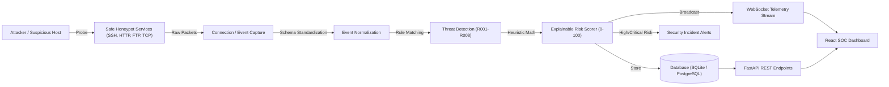

# Honeypot Trap System 🛡️
> **A Defensive Cybersecurity Honeypot, Threat Detection, Risk Scoring, and SOC Monitoring Platform**

[](https://www.python.org/)
[](https://fastapi.tiangolo.com/)
[](https://react.dev/)
[](https://tailwindcss.com/)
[](LICENSE)
[](backend/tests)

---

## 1. Project Overview

The **Honeypot Trap System** is an academic and production-grade prototype for defensive cybersecurity operations. It simulates intentionally attractive or vulnerable services (SSH, HTTP, FTP, and generic TCP), safely captures unauthorized interactions, normalizes event telemetry, evaluates behavioral patterns against rule-based threat detection engines, computes explainable heuristic risk scores (0–100), and presents actionable security intelligence through a modern dark-themed SOC monitoring dashboard.

### High-Level Workflow:


---

## 2. Defensive Security Boundaries & Guarantees

> [!IMPORTANT]
> **Defensive Security Notice**:
> - This system strictly monitors and captures activity directed at the honeypot itself.
> - **Zero offensive capabilities**: Does not create malware, persistence mechanisms, or retaliatory counter-attacks.
> - Simulated vulnerabilities are contained: No real operating system shell or filesystem access is ever granted.
> - Test traffic is isolated: Synthetic datasets exclusively use RFC-1918 private test IP ranges (`10.0.0.0/8`, `172.16.0.0/12`, `192.168.0.0/16`).
> - Passwords attempted by attackers are recorded as threat telemetry without authenticating against real accounts.

---

## 3. Technology Stack

- **Backend**: Python 3.13, FastAPI, Pydantic v2, SQLAlchemy 2.0, PyJWT, Bcrypt, Asyncio, WebSockets
- **Database**: SQLite (default zero-dependency local configuration) / PostgreSQL (production configurable via `DATABASE_URL`)
- **Frontend**: React 19, TypeScript, Vite, Tailwind CSS, Lucide React
- **Honeypot Services**:
  - Safe SSH Honeypot (`Port 2222`)
  - Safe HTTP Honeypot (`Port 8080`)
  - Safe FTP Honeypot (`Port 2121`)
  - Generic TCP Listener (`Port 9999`)
- **Testing**: Pytest, Asyncio, FastAPI TestClient
- **DevOps**: Docker, Docker Compose, Nginx

---

## 4. Project Directory Structure

```text
aics project/
├── backend/
│   ├── app/
│   │   ├── api/             # REST endpoints (auth, dashboard, events, detections, alerts, honeypots, reports, settings)
│   │   ├── core/            # Config, security (bcrypt/JWT), database engine, logging, DB init
│   │   ├── detection/       # Threat Detection Engine & Rules R001 to R008
│   │   ├── honeypot/        # Asynchronous mock listeners (SSH, HTTP, FTP, TCP, Manager)
│   │   ├── models/          # SQLAlchemy ORM models (Event, Detection, Alert, User, Session, IPStat, etc.)
│   │   ├── schemas/         # Pydantic v2 validation & response models
│   │   ├── services/        # Event processor, risk scorer, alert manager, IP tracker, WebSocket manager
│   │   └── main.py          # FastAPI application entrypoint with lifespan events
│   ├── tests/               # 22 automated unit and integration tests (100% passing)
│   └── requirements.txt
├── frontend/
│   ├── src/
│   │   ├── components/      # Navbar, Sidebar, SeverityBadge, RiskScoreBar, EventDetailModal
│   │   ├── pages/           # Dashboard, LiveEvents, ThreatAnalysis, Honeypots, Alerts, Reports, Settings, Login
│   │   ├── services/        # API client and WebSocket real-time hook
│   │   ├── types/           # TypeScript interfaces
│   │   ├── App.tsx          # Root application routing and live event bus
│   │   └── main.tsx
│   ├── package.json
│   ├── tailwind.config.js
│   └── vite.config.ts
├── scripts/
│   ├── generate_demo_data.py # Generates realistic synthetic telemetry dataset
│   └── simulate_traffic.py   # Live safe traffic simulator against active honeypot sockets
├── docs/
│   ├── architecture.md      # Detailed architectural specification & component interaction
│   ├── api.md               # Complete REST API & WebSocket documentation
│   ├── testing.md           # Comprehensive test guide & verification instructions
│   ├── deployment.md        # Production Docker and bare-metal deployment manual
│   └── PROJECT_REPORT.md    # 23-section Academic Project Report
├── Dockerfile.backend
├── Dockerfile.frontend
├── docker-compose.yml
├── nginx.conf
├── .env.example
└── README.md
```

---

## 5. Quick Start Installation

### Option A: Local Bare-Metal (Recommended for Quick Demo)

#### 1. Setup Backend:
```bash
cd backend
pip install -r requirements.txt

# Initialize database with default admin user & configuration:
python -m app.core.init_db

# Launch FastAPI backend & Honeypot Listeners:
python -m uvicorn app.main:app --host 127.0.0.1 --port 8000 --reload
```

#### 2. Setup Frontend:
```bash
cd frontend
npm install
npm run dev
```

Open your browser at `http://localhost:5173`.
- **Default Operator**: `admin`
- **Default Password**: `adminpassword123`

---

### Option B: Docker Compose

Build and launch the complete multi-container stack with a single command:
```bash
docker compose up --build
```

- **Frontend SOC Dashboard**: `http://localhost:3000`
- **Backend API & Swagger Docs**: `http://localhost:8000/docs`
- **Controlled SSH Honeypot**: `Port 2222`
- **Controlled HTTP Honeypot**: `Port 8080`
- **Controlled FTP Honeypot**: `Port 2121`
- **Generic TCP Listener**: `Port 9999`

---

## 6. Verification & Demonstration Guide

### Step 1: Run the Automated Test Suite
Execute the 22 automated test cases verifying authentication, detection rules, risk scoring, honeypot sockets, and security validation:
```bash
cd backend
pytest -v
```
*(All 22 tests execute and pass within ~6 seconds)*

### Step 2: Generate Synthetic Attack Dataset
Populate the database with 120+ realistic security events, brute-force attempts, path scans, and automated alerts:
```bash
python scripts/generate_demo_data.py 120
```

### Step 3: Run Live Socket Traffic Simulator
While the backend server is running, execute real network connections against active localhost listeners:
```bash
python scripts/simulate_traffic.py
```
This tests:
- SSH banner exchange on `127.0.0.1:2222`
- HTTP probe requests (`/wp-login.php`, `/.env`, etc.) on `127.0.0.1:8080`
- FTP authentication interactions on `127.0.0.1:2121`
- Generic TCP probes on `127.0.0.1:9999`

---

## 7. Threat Detection Rules Reference

| Rule ID | Rule Name | Severity | Heuristic Trigger Description |
| :--- | :--- | :--- | :--- |
| **R001** | Repeated Connection Attempts | `MEDIUM` | Single source IP executes > 5 connections in 60 seconds |
| **R002** | Repeated Failed Authentication | `HIGH` | Host accumulates >= 3 failed logins on SSH, FTP, or HTTP |
| **R003** | High Request Frequency / Burst | `MEDIUM` | Burst exceeding 8 requests within a 10-second interval |
| **R004** | Multiple Services Targeted | `HIGH` | Host contacts >= 2 distinct honeypot services |
| **R005** | Suspicious HTTP Request Pattern | `HIGH` | Web traversal (`/wp-login`, `/.env`, `/phpmyadmin`) or scanner User-Agent |
| **R006** | Suspicious Command Pattern | `CRITICAL` | Reconnaissance commands (`cat /etc/passwd`, `whoami`, `curl`, `powershell`) |
| **R007** | Port Scanning Pattern | `HIGH` | Rapid probes across >= 3 distinct destination ports |
| **R008** | Abnormally Long Session | `MEDIUM` | External client holds an active socket connection > 180 seconds |

---

## 8. Explainable Risk Scoring Formula

$$\text{FinalScore} = \min\left(100, \text{BaseScore} + \sum \text{RuleContributions} + \text{TestIndicator}\right)$$

- **LOW**: 0 – 29 pts (Normal connection probes)
- **MEDIUM**: 30 – 59 pts (Repeated interactions, minor scanner patterns)
- **HIGH**: 60 – 79 pts (Brute force attempts, multi-service targeting, web vulnerability probing)
- **CRITICAL**: 80 – 100 pts (Command injection payloads, post-exploitation activity)

Every event stores an itemized breakdown of contributing factors in its metadata for transparent auditability.

---

## 9. Dashboard Views

1. **Overview Dashboard**: Key SOC metric cards, 24-hour timeline bar chart, severity distribution, top targeted services, top source IPs, and live event ticker.
2. **Live Events**: Real-time event streaming table with risk score bars, search, severity/service filters, pagination, and click-to-inspect drawer.
3. **Telemetry Inspector**: Granular event drawer displaying network parameters, triggered detection rules with evidence, explainable scoring factors, and raw payload text.
4. **Threat Analysis**: Detection rule frequency charts and persistent attacker intelligence profiles.
5. **Honeypot Services**: Active listener cards with live status indicators and start/stop controls.
6. **Incident Alerts**: Alert triage center for acknowledging and resolving high/critical incidents.
7. **Reports & Exports**: Intelligence synopsis generator with one-click CSV and JSON export.
8. **Settings**: Detection rule toggle switches and dynamic risk scoring factor weight sliders.

---

## 10. Documentation Index

- [System Architecture & Design Document](docs/architecture.md)
- [REST API & WebSocket Documentation](docs/api.md)
- [Testing & Verification Guide](docs/testing.md)
- [Deployment & Operations Manual](docs/deployment.md)
- [Comprehensive Academic Project Report](docs/PROJECT_REPORT.md)

---

## 11. Academic Evaluation & License

Developed as an academic cybersecurity project demonstrating defensive deception techniques, protocol emulation, threat intelligence correlation, and real-time telemetry streaming.

Released under the **MIT License**.
