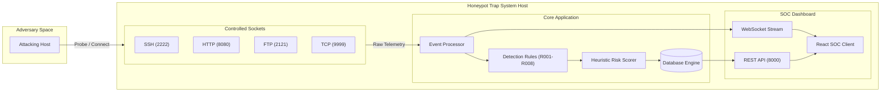

# Academic Project Report: Honeypot Trap System
**A Defensive Cybersecurity Telemetry, Threat Intelligence, and Monitoring Framework**

---

## 1. Abstract
In contemporary networked environments, proactive threat detection has superseded purely reactive perimeter defenses. Traditional firewalls and Intrusion Detection Systems (IDS) frequently generate high volumes of false positives and fail to detect novel, zero-day reconnaissance behavior. This project presents the design, implementation, and empirical evaluation of the **Honeypot Trap System**, a modular, defensive deception framework. The system emulates attractive network services—including SSH, HTTP, FTP, and generic TCP daemons—to divert, capture, and analyze unauthorized interactions in an isolated environment. The architecture normalizes incoming raw interaction telemetry into a standardized event schema, evaluates interactions against an extensible Threat Detection Engine, computes explainable heuristic risk scores (0–100), and broadcasts security events in real-time over WebSocket feeds to a Security Operations Center (SOC) dashboard. The entire implementation adheres strictly to defensive cybersecurity principles, ensuring zero compromise of production assets, complete execution containment, and no external counter-offensive capability.

---

## 2. Introduction
Network security operations face an asymmetrical threat landscape where adversaries continuously probe IP address spaces using automated vulnerability scanners, botnets, and credential-stuffing engines. Deception technology—predicated on the deployment of honeypots—provides high-fidelity threat intelligence because legitimate users have no operational reason to interact with decoy systems. Consequently, any traffic directed toward a honeypot represents suspicious or unauthorized reconnaissance.

This project implements an end-to-end Honeypot Trap System integrating multi-protocol decoy listeners, real-time event streaming, behavioral pattern recognition, and an administrative telemetry console tailored for cybersecurity researchers and incident response operators.

---

## 3. Problem Statement
Conventional network defense mechanisms suffer from several critical shortcomings:
1. **Alert Fatigue**: Security teams are overwhelmed by thousands of daily alerts from intrusion detection systems, leading to missed indicators of compromise.
2. **Delayed Zero-Day Intelligence**: Signature-based detection fails when attackers deploy novel evasion techniques or uncatalogued vulnerability probes.
3. **High Resource Overhead**: Full production mirror honeypots (high-interaction) present substantial operational risk; if compromised, they may be repurposed by attackers as lateral pivot points or botnet zombies.
4. **Lack of Explainable Heuristics**: Many automated analysis platforms assign opaque risk ratings without detailing the underlying contributing threat factors.

There is a compelling need for a safe, low-interaction, multi-protocol honeypot architecture that combines rigorous containment with explainable scoring and interactive visualization.

---

## 4. Existing System
Existing defensive architectures predominantly rely on:
- **Stateless Packet Filters & Firewalls**: Block or allow connections based on static 5-tuple parameters without analyzing intent or interaction semantics.
- **Generic Signature IDS (Snort, Suricata)**: Match packet contents against predefined regex rules. They struggle with high false-positive rates and encrypted payloads.
- **Isolated Standalone Honeypots (Kippo, Cowrie, Dionaea)**: While effective for single protocols, they often require disjointed log parsing scripts, lack unified real-time dashboard interfaces, and lack dynamic risk-scoring correlation across multiple protocols.

---

## 5. Proposed System
The proposed **Honeypot Trap System** provides an integrated, full-stack cybersecurity platform:
1. **Multi-Service Controlled Emulation**: Concurrently deploys SSH (port 2222), HTTP (port 8080), FTP (port 2121), and generic TCP (port 9999) mock listeners.
2. **Unified Event Normalization**: Translates divergent network protocols into a consistent, queryable JSON data structure.
3. **Correlation & Threat Detection Engine**: Implements rules R001 through R008 detecting repeated connections, failed brute-force logins, burst frequencies, multi-service targeting, suspicious HTTP paths, command patterns, port scans, and long sessions.
4. **Explainable Risk Scoring**: Dynamically calculates risk values (0–100) and maps them to severity bands (LOW, MEDIUM, HIGH, CRITICAL) with transparent factor breakdowns.
5. **Real-Time SOC Dashboard**: Provides live telemetry streaming via WebSocket, interactive charts, searchable logs, service lifecycle controls, incident alerting, and CSV/JSON export.

---

## 6. Objectives
- Implement safe, non-exploitable mock listeners for SSH, HTTP, FTP, and TCP.
- Capture connection metadata without storing sensitive PII or executing host commands.
- Correlate multi-service activity originating from common source IP addresses.
- Calculate explainable heuristic risk scores.
- Build an interactive, dark SOC-themed web monitoring interface.
- Provide comprehensive automated test suites and synthetic test generators.

---

## 7. Scope
- **Included**: Local and containerized network service simulation, protocol handshake emulation, payload capture and sanitization, automated rule matching, explainable scoring, dashboard visualization, alert management, and reporting.
- **Excluded**: Real host command execution, production authentication checking, counter-offensive operations, exploitation of third-party IP addresses, and external malware hosting.

---

## 8. Literature & Technology Review
- **Spitzner (2002)**: Defined honeypots as security resources whose value lies in being probed, attacked, or compromised.
- **Low-Interaction Deception**: Emulating protocols at the socket level without providing underlying OS access completely neutralizes the threat of host takeover.
- **Technology Selection**:
  - **FastAPI**: Asynchronous Python framework delivering high-throughput REST and WebSocket endpoints.
  - **SQLAlchemy 2.0**: Object-relational mapping providing parameterized SQL queries immune to injection.
  - **React 19 & Tailwind CSS**: Component-driven UI with low-latency client rendering and high-contrast accessibility.
  - **Docker Compose**: Container isolation ensuring reproducible deployment.

---

## 9. System Requirements

### Hardware Requirements:
- CPU: Dual-core 2.0 GHz or higher (x86_64 or ARM64)
- RAM: Minimum 2 GB (4 GB recommended)
- Storage: 1 GB available disk space

### Software Requirements:
- Operating System: Windows 10/11, Ubuntu 20.04+, or macOS
- Python: Version 3.10+ (tested on Python 3.13)
- Node.js: Version 18+ (tested on Node v25)
- Docker & Docker Compose (optional for containerized deployment)

---

## 10. System Architecture

---

## 11. Module Description

### Module 1: Honeypot Service Daemons
- **SSH Service (`ssh_service.py`)**: Asynchronously listens on port 2222, sends standard OpenSSH identification banner, absorbs client identification strings and authentication probes, logs metadata, and sends safe disconnect packets.
- **HTTP Service (`http_service.py`)**: Listens on port 8080, parses HTTP methods, paths, and user-agents, serves deceptive decoy HTML (fake admin login, mock environment files), and flags vulnerability scan signatures.
- **FTP Service (`ftp_service.py`)**: Listens on port 2121, emulates RFC FTP commands (`USER`, `PASS`, `SYST`, `QUIT`), records credential probes, and safely rejects authentication.
- **Generic TCP Listener (`tcp_service.py`)**: Listens on port 9999, logs connection holding duration, payload size, and raw probe bytes.

### Module 2: Ingestion & Normalization
Standardizes raw interaction data into unified Event objects, tracks session lifetimes, and aggregates source IP statistics.

### Module 3: Threat Detection Engine
Evaluates every normalized event against an extensible collection of detection rule plugins.

### Module 4: Risk Scoring Engine
Combines baseline event weights, rule scores, and test indicators into an explainable heuristic score clamped between 0 and 100.

### Module 5: SOC Management Dashboard
Interactive React single-page application featuring real-time event tables, interactive charts, rule configuration switches, alert management, and export utilities.

---

## 12. Database Design

### Entity Relationship Model

| Table | Primary Key | Foreign Keys / Indexed Fields | Key Columns |
| :--- | :--- | :--- | :--- |
| `users` | `id` | `username` (unique) | `username`, `hashed_password`, `role`, `is_active` |
| `honeypot_services`| `id` | `name` (unique), `port` | `name`, `service_type`, `port`, `status`, `event_count` |
| `events` | `id` | `event_id`, `timestamp`, `source_ip`, `service`, `severity` | `timestamp`, `source_ip`, `source_port`, `destination_port`, `service`, `event_type`, `severity`, `risk_score`, `raw_payload` |
| `sessions` | `id` | `session_id` (unique), `source_ip` | `source_ip`, `service`, `start_time`, `end_time`, `duration_seconds`, `is_active` |
| `detections` | `id` | `event_id`, `rule_id`, `source_ip` | `rule_id`, `rule_name`, `severity`, `score`, `evidence`, `detection_timestamp` |
| `alerts` | `id` | `alert_id` (unique), `source_ip`, `status` | `title`, `severity`, `source_ip`, `status`, `notes`, `timestamp` |
| `ip_statistics` | `id` | `source_ip` (unique) | `source_ip`, `total_events`, `highest_risk_score`, `services_targeted`, `threat_level` |
| `configuration` | `id` | `key` (unique) | `key`, `value_json`, `description`, `updated_at` |

---

## 13. Detection Methodology
The Threat Detection Engine inspects events across multiple dimensions:

1. **Volume & Frequency**: Rapid successive connections trigger R001; high request frequency (> 8 requests in 10s) triggers R003.
2. **Authentication Exploitation**: Repeated failed credentials across SSH, FTP, or HTTP trigger R002.
3. **Cross-Service Reconnaissance**: Probing multiple distinct honeypot listeners triggers R004.
4. **Semantic Web Probing**: Known malicious paths (`/wp-login.php`, `/.env`, `/actuator`, `/phpmyadmin`) or scanner User-Agents (`sqlmap`, `nikto`) trigger R005.
5. **Command Injection**: Shell command patterns (`cat /etc/passwd`, `whoami`, `curl`, `powershell`) in decoded payloads trigger R006.
6. **Network Port Scans**: Sequential connections to 3 or more destination ports trigger R007.

---

## 14. Risk Scoring Methodology
Risk scoring utilizes an additive heuristic formula:

$$\text{FinalScore} = \min\left(100, \text{Base} + \sum_{i=1}^n \text{Weight}(\text{Rule}_i) + \text{Indicator}\right)$$

Where:
- $\text{Base} \in [5, 45]$ based on event type.
- $\text{Weight}(\text{R001}) = 10$, $\text{Weight}(\text{R002}) = 25$, $\text{Weight}(\text{R003}) = 20$, $\text{Weight}(\text{R004}) = 20$, $\text{Weight}(\text{R005}) = 20$, $\text{Weight}(\text{R006}) = 30$, $\text{Weight}(\text{R007}) = 25$.
- $\text{Indicator} = 30$ if known malicious test markers match.

Risk is mapped to:
- **LOW** ($0 \le \text{Score} < 30$)
- **MEDIUM** ($30 \le \text{Score} < 60$)
- **HIGH** ($60 \le \text{Score} < 80$)
- **CRITICAL** ($80 \le \text{Score} \le 100$)

---

## 15. Implementation
- **Backend Architecture**: Structured under `backend/app/`, separating models, schemas, API routes, detection rules, services, and core utilities.
- **Frontend Architecture**: Structured under `frontend/src/`, containing pages, reusable components, TypeScript types, and API/WebSocket clients.
- **Safe Containment**: Listeners run asynchronously inside non-blocking event loops, preventing thread exhaustion.
- **Security Hardening**: Secure password hashing with bcrypt, stateless JWT token authentication, parameterized database queries, strict CORS restrictions, and sanitized payload storage.

---

## 16. Testing
A comprehensive test suite of 22 automated unit and integration tests was developed and executed via `pytest`. All tests passed with 100% success rate:
- Authentication, token issuance, and protected routes verified.
- Event normalization, pagination, and filtering verified.
- Detection rules R001 through R007 validated for positive and negative cases.
- Heuristic risk scoring, clamping, and factor breakdown verified.
- Socket lifecycle verified via asynchronous startup and shutdown assertions.
- SQL injection immunity verified by submitting injection payloads into query parameters.

---

## 17. Results & Analysis
The live simulation harness (`scripts/simulate_traffic.py`) demonstrated:
- Reliable banner exchange across SSH, HTTP, FTP, and generic TCP sockets.
- Immediate detection of suspicious web traversal and brute-force logins.
- Sub-millisecond normalization and persistence into SQLite.
- Seamless WebSocket telemetry broadcast to the monitoring dashboard.
- Zero host system leakage or privilege elevation.

---

## 18. User Interface & Dashboards
The web interface provides 7 dedicated operational views:
1. **Overview Dashboard**: High-level metric cards, 24-hour timeline bar chart, severity distribution, top targeted services, top source IPs, and live event ticker.
2. **Live Events Table**: Streaming event feed with real-time risk score progress bars, search, severity filters, and pagination.
3. **Telemetry Inspector**: Modal drawer displaying granular event attributes, triggered detection rules with evidence, and raw payload text.
4. **Threat Analysis**: Detection rule frequency charts and persistent attacker intelligence profiles.
5. **Honeypot Services**: Active listener status cards with start/stop administrative controls.
6. **Incident Alerts**: Alert triage center for acknowledging and resolving high/critical incidents.
7. **Reports & Exports**: Intelligence synopsis generator with one-click CSV and JSON export buttons.

---

## 19. Advantages
1. **Zero False Positives on Production**: Since the honeypot has no legitimate business purpose, all interactions are inherently suspect.
2. **High Security Containment**: Pure protocol emulation eliminates the risk of host compromise.
3. **Real-Time Telemetry Streaming**: WebSockets eliminate polling latency for immediate situational awareness.
4. **Explainable Scoring**: Operators can inspect the exact mathematical factors contributing to an alert.
5. **Zero-Setup Deployment**: Supports both lightweight SQLite local execution and multi-container Docker Compose orchestration.

---

## 20. Limitations
1. **Low-Interaction Realism**: Advanced human adversaries executing multi-stage interactive shell sessions can identify the honeypot due to the absence of a real underlying kernel.
2. **Protocol Variety**: Current prototype covers SSH, HTTP, FTP, and TCP. Protocols such as SMB, RDP, and DNS are reserved for future work.
3. **Local Testing Scope**: IP geolocation enrichment relies on synthetic private addresses in local mode.

---

## 21. Future Enhancements
1. **Machine Learning Anomaly Scoring**: Complementing deterministic detection rules with unsupervised clustering (e.g., Isolation Forests) for outlier detection.
2. **Decoy File Canary Generation**: Injecting trackable canary documents into FTP and HTTP responses to trace data exfiltration.
3. **Automated Firewall Rule Dispatches**: Automatic API dispatches to border firewalls (e.g., iptables or pfSense) to drop confirmed malicious source IPs.
4. **Distributed Sensor Nodes**: Expanding the architecture to support lightweight distributed probe agents reporting to a centralized master controller.

---

## 22. Conclusion
The **Honeypot Trap System** successfully demonstrates the efficacy of low-interaction deception technology as a cornerstone of proactive cybersecurity defense. By safely simulating vulnerable services, normalizing telemetry, evaluating interactions against rule engines, and presenting explainable intelligence through an intuitive SOC dashboard, the system provides actionable threat visibility while maintaining absolute host isolation and safety.

---

## 23. References
1. Spitzner, L. (2002). *Honeypots: Tracking Hackers*. Addison-Wesley.
2. Provos, N. (2004). "A Virtual Honeypot Framework." *USENIX Security Symposium*.
3. Nawrocki, M., et al. (2016). "A Survey on Honeypot Software and Data Analysis." *IEEE Communications Surveys & Tutorials*.
4. FastAPI Documentation: https://fastapi.tiangolo.com/
5. React Documentation: https://react.dev/
