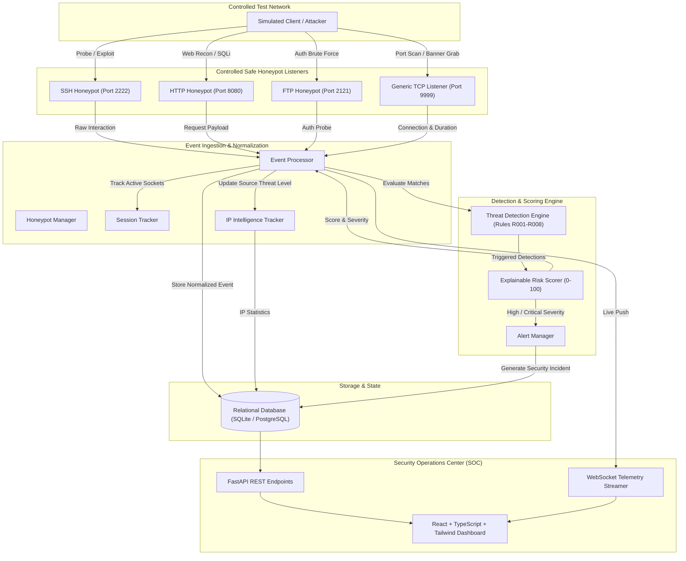

# Honeypot Trap System - System Architecture & Design

## 1. High-Level Architectural Overview

The **Honeypot Trap System** is a defensive, decoupled cybersecurity architecture engineered to deploy controlled decoy network services, capture unauthorized and suspicious interactions, normalize telemetry, evaluate activity against automated threat detection rules, compute transparent risk scores, and stream real-time events to a SOC monitoring dashboard.



---

## 2. Component Specifications

### A. Honeypot Decoy Layer
Each honeypot runs as an isolated asynchronous daemon using Python's native `asyncio.start_server`. No real operating system shells, bash binaries, or filesystem privileges are granted:
- **SSH Honeypot (`Port 2222`)**: Emulates standard OpenSSH banner exchanges (`SSH-2.0-OpenSSH_8.9p1 Ubuntu-3ubuntu0.1`), absorbs identification probes and brute-force credentials, and terminates connections safely with disconnect payloads.
- **HTTP Honeypot (`Port 8080`)**: Parses HTTP methods (GET, POST), URLs, query strings, headers, and user-agents. Responds with deceptive decoy web pages (such as fake administrative portals or mock environment configurations) while trapping malicious directory traversal and injection queries.
- **FTP Honeypot (`Port 2121`)**: Emulates ProFTPD banner exchanges, handles `USER` and `PASS` commands, records authentication probes, and returns RFC-compliant rejection codes (`530 Login incorrect`).
- **Generic TCP Listener (`Port 9999`)**: Low-interaction raw socket capturing connection attempts, connection holding duration, payload size, and banner grabs.

### B. Event Normalization Pipeline
The `EventProcessor` standardizes raw protocol events into a unified schema:
```json
{
  "event_id": "b6a71f00-34d2-432d-8b01-e23e2fb3bc6a",
  "timestamp": "2026-09-29T21:40:00Z",
  "source_ip": "192.168.1.105",
  "source_port": 49822,
  "destination_port": 8080,
  "protocol": "TCP",
  "service": "HTTP Honeypot",
  "event_type": "SUSPICIOUS_REQUEST",
  "severity": "HIGH",
  "risk_score": 75,
  "session_id": "9a008c2a-89aa-4034-8c81-81d77a06c101",
  "metadata": {
    "path": "/wp-login.php",
    "method": "POST",
    "user_agent": "sqlmap/1.6"
  }
}
```

### C. Threat Detection Engine
Operates as an extensible registry of rule plugins (`DetectionRule` interface):
- `R001`: Repeated Connection Attempts (> 5 attempts in 60s)
- `R002`: Repeated Failed Authentication (>= 3 failed logins in 5m)
- `R003`: High Request Frequency / Burst (> 8 requests in 10s)
- `R004`: Multiple Services Targeted (>= 2 distinct honeypot listeners)
- `R005`: Suspicious HTTP Request Pattern (admin paths, `.env`, sqlmap, nikto)
- `R006`: Suspicious Command Pattern (payloads containing `cat /etc/passwd`, `whoami`, `curl`, `powershell`)
- `R007`: Port Scanning Pattern (>= 3 distinct ports probed rapidly)
- `R008`: Abnormally Long Interactive Session (> 180s holding socket open)

### D. Explainable Risk Scoring Engine
The heuristic risk score is strictly calculated within the range `[0, 100]`:
$$\text{Score} = \min(100, \text{BaseScore} + \sum \text{RuleContributions} + \text{TestIndicator})$$

Severity bands:
- **LOW**: 0 – 29
- **MEDIUM**: 30 – 59
- **HIGH**: 60 – 79
- **CRITICAL**: 80 – 100

Each processed event stores an itemized breakdown of triggered factors for auditability and transparency.

---

## 3. Defensive Security Boundaries & Isolation Guarantees
1. **Zero External Offensive Action**: The honeypot system strictly monitors inbound traffic directed at its designated ports. It never performs counter-attacks, port scans, or retaliatory exploits.
2. **Containment**: All emulated protocols are software-mocked; attacker commands are never passed to the host operating system shell.
3. **Data Sanitization**: Collected payloads are truncated and sanitized. Passwords and credentials attempted by external probes are stored only as threat telemetry without authenticating against real system accounts.
4. **Authentication Barrier**: Administrative control and dashboard telemetry are protected by JWT tokens with bcrypt-hashed credentials and role-based access checks.
